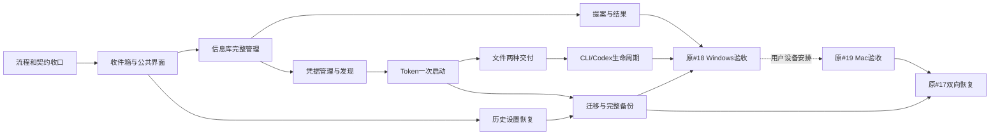

# 后续开发计划与实施任务

状态更新：2026-10-17。规划和GitHub任务已发布；用户后续已授权自主实施，D0（#22）已完成并合入，D1（#23）实施中，其余仍按依赖推进。D编号是稳定设计编号，实际Issue见下方发布映射。以下勾选项保留为验收清单，实际完成证据以对应Issue及[执行记录](../windows-and-sync-execution.md)为准。依据：[设计复核](design-review.md)、[旧票调整表](tracker-adjustments.md)、[运行时注入设计](../../design/credential-runtime-injection.md)。

## 发布映射

| 设计编号 | GitHub任务 | 直接依赖 |
| --- | --- | --- |
| E0 | [#21 按已确认原型升级桌面流程，并加入托管凭据运行时使用](https://github.com/ShiJiJS/agent-info-manage/issues/21) | 子任务汇总 |
| D0 | [#22 补齐全流程原型和实施契约](https://github.com/ShiJiJS/agent-info-manage/issues/22) | 无 |
| D1 | [#23 在新收件箱中处理普通读取与整理申请](https://github.com/ShiJiJS/agent-info-manage/issues/23) | #22 |
| D2 | [#24 信息库三栏承载完整管理与恢复](https://github.com/ShiJiJS/agent-info-manage/issues/24) | #23 |
| D3 | [#25 完整核对录入、修改、删除与整理结果](https://github.com/ShiJiJS/agent-info-manage/issues/25) | #24 |
| D4 | [#26 授权历史、设置与现有备份恢复闭环](https://github.com/ShiJiJS/agent-info-manage/issues/26) | #23 |
| D5 | [#27 保存、发现和关联托管凭据](https://github.com/ShiJiJS/agent-info-manage/issues/27) | #24 |
| D6 | [#28 通过一次批准用Token启动一个命令](https://github.com/ShiJiJS/agent-info-manage/issues/28) | #27 |
| D7 | [#29 文件凭据以参数和环境变量路径交付](https://github.com/ShiJiJS/agent-info-manage/issues/29) | #28 |
| D8 | [#30 CLI/Codex接入、执行中状态与生命周期恢复](https://github.com/ShiJiJS/agent-info-manage/issues/30) | #29 |
| D9 | [#31 托管凭据迁移与完整备份格式升级](https://github.com/ShiJiJS/agent-info-manage/issues/31) | #26、#28 |

## 推荐顺序

先补流程，再把现有能力接到新界面，最后加入凭据执行。保留现有Flutter/Dart与加密核心；HTML用作视觉和行为规范，不以整套重写取代已有业务。

| 阶段 | 任务 | 用户能检查的成果 | 进入下一阶段的条件 |
| --- | --- | --- | --- |
| 0 设计收口 | D0及旧票正文整理 | 全流程覆盖表、缺口原型、三类授权状态与期限一致 | 四项产品决定已明确，原型与规格无冲突 |
| 1 新界面接旧能力 | D1–D4 | 真正能录入/编辑/审批/整理/恢复的信息软件，沿用round05风格 | 旧行为回归与Windows代表流程通过；不是仅有静态新皮肤 |
| 2 凭据管理与字符串使用 | D5、D6 | 加密保存Token，关联信息，发现/申请/批准后CLI启动一个非交互命令 | 跨会话/版本/次数/失败拒绝，历史与输出协议验证通过 |
| 3 文件及接入 | D7、D8 | 文件路径参数、文件路径环境变量；真实CLI/Codex使用与生命周期 | 残留清理、崩溃/重启、工具账号优先级验证通过 |
| 4 数据与交付 | D9，续作#17/#18/#19 | 升级、完整加密备份、干净Windows验收；随后用户Mac与双向恢复 | 以实际平台证据决定完成状态，缺失项保留开放 |

D9在D5/D6模型稳定后即可开展，不必等所有界面完工。D5–D9未闭合前只使用虚构凭据；不能先交付会漏备份的真实凭据管理。

## 当前执行与衔接

- D0已经冻结[协议v1](../../design/runtime-protocol-v1.md)、[请求schema](../../design/runtime-request-v1.schema.json)及[F01–F14覆盖表](../../design/round05-flow-coverage.md)。后续票直接按此实现；原型和Windows业务验收分别记录。
- D1合入并复验后，D2和D4可以并行；D2交付共享编辑草稿后，D3复用它。D5依赖D2的信息身份及关联入口。每个合入点重查真实阻塞边，不因旧跨平台票仍OPEN而重复实现既有能力。
- [接口与数据格式协调](../round05-interface-coordination.md)统一主题、编辑草稿、字段恢复身份及数据库/备份版本分配。D4负责普通请求终态的非秘密历史；D1不把活动会话持久化为可恢复许可。D5与D9接续凭据及完整备份，不各自跳过并行任务的迁移。
- 当前集成分支为`codex/round05-windows-sync`，草稿PR #32；PR #20保留旧实现基线。Mac实机与跨平台验收按新授权暂缓，#17/#19保留开放。完成Windows后继续另立服务器同步规格、任务及实现，见[完整执行范围](../windows-and-sync-execution.md)。

不估算没有依据的工期。每个任务交付一次可演示的纵向流程，记录固定源码、自动验证与原生验收分别完成了什么。

## 首版采用的默认方案

具体规则以[运行时实施契约](../../design/runtime-implementation-contract.md)为准；本轮规划收口，不冒充逐项用户选择。

- 首版SSH只支持明确的非交互远程命令，不做PTY或私钥口令交互。
- 每次申请一个凭据，同一引用可复用；三种交付方式均保留。
- 组合审批可部分批准，生成分别计时和记录的字段/使用许可；组合字段默认同15/30分钟，独立读取仍8小时。整单撤销两项，运行只消费使用许可。
- 旧秘密版本和删除的凭据加密保留30天，不能直接使用；恢复为停用的新版本，旧许可不复活；默认不向Agent公开发现。

D0负责补原型、状态覆盖和冻结协议参数，不再等待上述产品选择；若工程证据迫使改变边界再提出具体差异。

## 升级父任务 E0

标题：按已确认原型升级桌面流程，并加入托管凭据运行时使用。

范围：D0–D9。关联原规格#1与旧功能票，不覆盖它们的实现/验收历史。链接可在发布时替换为实际Issue及仓库中的设计资料；不得把localhost或作者本机绝对路径作为唯一验收依据。

完成条件：已确认页面和关键异常状态在Flutter实现；旧授权/整理/信息生命周期不回归；凭据两种保存形式、三种交付方式、一次启动与清理闭环；完整备份/升级；声明的平台验收完成。只交Windows开发预览时，Mac仍开放，不把E0标成全平台交付。

## D0 · 补齐全流程原型和实施契约

类型：设计收口，不实现业务。依赖：用户已接受round05方向；无须等待旧平台票关闭；已归档round05基线，缺口补齐仍未完成。

- [ ] 保留现有视觉，补齐设计复核F01–F14的入口/状态覆盖表；每项标明原型位置、既有实现、待开发票。
- [ ] 普通读取补选/改选和8小时；整理完成即失效；请求过期/取消/撤销、搜索无结果不保留错误详情。
- [ ] 画出新建/编辑、回收站/版本恢复、提案完整编辑、备份首次启用/空库恢复、凭据换版本/停用及运行失败。
- [ ] 落实实施契约中的四项默认方案及组合授权规则；写出申请/授权/执行/清理状态表和失败重试条件。
- [ ] 将批准版本原型及必要字体许可、截图、可复现预览说明复制为生产仓库内可版本化的设计资产；保留来源，去除真实个人资料，不依赖video_viewer工作区或8794端口。
- [ ] 对齐原规格的旧排除项、ADR边界和当前设计；新增规划默认方案明确标注来源，任何修改同步Issue正文及原生关系。

演示：只看原型，从新建信息到审批、修改/删除恢复，以及凭据申请到失败恢复，能指出每一步与对应状态。未接后台的动作仍明确记为原型。

## D1 · 在新收件箱中处理普通读取与整理申请

依赖：D0；复用#4/#5/#8/#9已集成服务能力，而不是等待这些跨平台票全部关闭。实施前核查集成提交仍可用。

- [ ] Flutter落地顶部导航、四主题、列表/详情/决策栏、共享文本与控件；偏好重启可读回，写入失败可恢复。
- [ ] 收件箱使用明确状态、稳定排序与分页/有界查询；数百请求下搜索、翻页、详情定位一致，保存滚动和选择。
- [ ] 普通读取显示原申请及最终字段集合，跨项补选/改选，8小时默认及自定义期限；已处理/过期/取消禁用决定。
- [ ] 整理一次批准包含固定元数据范围与分类写入，不增加第二次确认；完成/无改动/冲突链接一致的结果与历史。
- [ ] 批准/拒绝处理中防重复操作；失败保留选择；服务断开和异步目标变化有可恢复反馈；通知点击定位对应请求。
- [ ] 1280×800、1440×900、200%文字及长名称，键盘焦点、独立滚动、空状态都验证；不只测默认小样。

验收：真实通用CLI申请→桌面缩小/补选→CLI返回实际范围→重复读取/拒绝未批字段；再跑整理完成后的失效。新增凭据请求的卡片集成在D6。

## D2 · 信息库三栏承载完整管理与恢复

依赖：D1；复用#3/#9/#10/#14/#15。

- [ ] 目录树用稳定ID与父子关系，支持新增/重命名/移动及防环；包含下级与标签筛选规则明确，移分类不扩大授权。
- [ ] 中间列表保留；查询/分页或虚拟列表有界，搜索无结果清空详情；删除当前项、刷新和切目录后选择一致。
- [ ] 手动新建、模板套用、字段及私有说明编辑、公开目录预览、分类标签编辑均可到达；未保存离开可保留或明确放弃。
- [ ] 新增/删除/语义替换字段按既有身份规则；普通值修正仍可用旧授权读取，新字段不自动授权。
- [ ] 回收站与修改历史分开：30天、差异、恢复确认、版本冲突；恢复不复活旧权限，失败不丢输入。
- [ ] 凭据关联区域为独立对象引用，接口由D5接入；不能用普通字段编辑器保存文件字节或暗中升级为凭据。

验收：模板新建→编辑→改分类→删除字段→回收恢复→重授权→历史恢复；核对所有步骤当前内容和授权范围。

## D3 · 完整核对录入、修改、删除与整理结果

依赖：D2；复用#11/#13/#14/#9及已验收的D2编辑/详情入口。

- [ ] 队列能分别辨认待确认提案、版本冲突与已完成整理结果，保留搜索/分页位置；不以导航名“录入”隐藏修改/删除。
- [ ] 单项独立编辑完整字段、分类、标签及公开说明；保存只改草稿；确认整批原子入库；失败保留草稿。
- [ ] 展示新增/移除/语义替换与普通修改差异；基础版本冲突不可直接覆盖，重提给出明确返回路径。
- [ ] 拒绝、重复确认、终态回执正确；确认后按真实ID读取当前资料，不继续显示共享草稿或已删除旧值。
- [ ] 整理结果只读，有改动和无改动都有入口；与请求/授权同一身份关联，完成状态一致。
- [ ] 长批次、空批次/全部无效、保存失败、撤销/版本竞争有验证；确认/取消等键盘焦点回到正确对象。

验收：CLI提交两项→只改一项草稿→故障后重试→确认→修改当前值→从终态提案打开当前值；另外验证拒绝、删除与冲突。

## D4 · 授权历史、设置与现有备份恢复闭环

依赖：D1；复用#8/#10/#12/#16/#17；凭据专属执行事件在D6–D9扩展。

- [ ] 历史区分批准范围、实际成功/失败访问与整理提交；固定批准快照，不因改名改写；撤销后的新读取失败。
- [ ] 请求与授权终态可查；主题/通知/等待期限/模板设置持久化且失败可解释；等待期限仅影响新请求。
- [ ] 审计默认90天，可选30/90/180/365；缩短前展示真实影响数量并确认；回收站/内容版本30天单独说明。
- [ ] 备份首次启用、独立保存恢复密钥、导出中/成功/失败、选择文件、空库恢复预览/确认/失败完整；非空库不覆盖合并。
- [ ] 关闭窗口继续后台、完全退出服务、启动密钥/加密引擎异常不覆盖原库；服务不可用和通知不可用不可混成同一成功提示。
- [ ] 故障与重试后重读真实结果；桌面导出/恢复不只演示说明弹窗。

验收：旧信息模型导出→独立空库恢复→历史仅作过去事实；设置失败与记录清理提示；新格式凭据备份验收在D9。

## D5 · 保存、发现和关联托管凭据

依赖：D2；采用D0冻结的生命周期/公开范围和D1/D2对象入口；复用加密存储、系统密钥与事务。

- [ ] 字符串与文件为独立托管对象；文件保存字节副本和显示元数据，不依赖原路径；导入大小/格式限制明确，取消/失败不留下半对象。
- [ ] 桌面添加、备注/公开说明修改、换版本、停用和删除影响预览；旧授权版本不可偷偷升级，过期/停用阻止新申请或使用。
- [ ] 多对多关联信息，不复制秘密；删信息或解除关联不隐式删除凭据，历史保留批准名称/版本事实。
- [ ] Agent通过受控目录只发现允许公开的名称、用途、形式、当前版本和稳定ID；关联及内部分类不自动全公开，无值/字节/源路径。
- [ ] 默认环境变量名/文件别名仅是建议，实际注入位置属于每次启动计划；类型/命名冲突正确报错。
- [ ] 加密保存、升级、重开与失败原子性验证；D9完成前明确禁止把此版本作为已支持真实凭据备份的正式交付。

验收：添加虚构字符串和文件→重开→关联两条信息→目录发现→停用/更换→原使用请求明确失效；公开接口与日志不含秘密。

## D6 · 通过一次批准用Token启动一个命令

依赖：D1、D5及D0的组合授权/数量决定；复用现有私密会话证明和通用CLI。

- [ ] 按D0协议v1完成发现→`request-use`→审批→`run-use`→执行记录的字符串纵向流程；不得在实现中另造不兼容的同名接口。
- [ ] 提交后固定credentialId/version、绝对exe、argv、cwd、env映射；完整展示；run-use仅引用获批计划，不接受替换命令。普通请求ID不能代替私密授权。
- [ ] 类型化引用校验；秘密不进argv；明确不支持的shell字符串、脚本包装与环境覆盖应拒绝而非隐式执行。基础环境及工具已有登录信息的优先级有确定规则。
- [ ] 原子占用一次启动尝试，复核会话/版本/停用/撤销/到期；并发最多一次；准备或启动失败不自动重试、不恢复次数；断线重连只能查原执行。
- [ ] 执行材料走私有通道且不进通用JSON响应；子进程不能继承本软件会话/授权秘密。输出作为executionId事件，stdout/stderr顺序/截断/退出码明确，不与协议混流。
- [ ] 已批准未启动、运行中、成功/非零退出、失败/未知、撤销/过期均有历史和恢复路径；只记录元数据，不保存秘密或完整输出。
- [ ] 组合字段许可，独立领取/期限/撤销规则按D0实现，字段权限不等于凭据权限。

验收：先用本机受控程序验证环境与参数边界、跨会话拒绝和并发一次，再在用户安排下验证gh支持的调用。已有凭据来源不能让未批准请求悄悄使用另一个账号。

## D7 · 文件凭据以参数和环境变量路径交付

依赖：D6；采用已确定的非交互SSH范围。

- [ ] `{"file":"alias"}`在argv中变成一个完整路径参数，或在指定env中变成文件路径；UI显示 `{{file:alias}}`，不经shell再次解释。
- [ ] 空格/中文路径、重复合法引用、字面占位符文本、类型错误、未知引用、Windows大小写变量冲突均验证；拒绝拼接式路径占位符。
- [ ] 私有受管临时目录，受限ACL/权限、独占创建、防符号链接/路径穿越；全体材料准备成功才启动，失败清理部分材料。
- [ ] 进程结束清理；清理失败单独可见/可安全重试；崩溃登记残留、重启检查不误删源文件或其他运行所需文件。不能仅凭父进程退出断言所有后代结束。
- [ ] 同一授权不能重放；终止/断线/完全退出时执行结果与残留状态可解释；工具非零退出与文件清理互不覆盖。
- [ ] 测试SSH `-i` 与AWS文件变量两种接收方式；非交互测试也要处理主机确认等实际失败，不自动放宽主机验证或复制现有登录配置。

验收：受控文件读取程序验证字节与路径准确、失败清理与权限，随后工具实测；如果PTY未入范围，裸交互命令不得被UI和文档标成已支持。

## D8 · CLI/Codex接入、执行中状态与生命周期恢复

依赖：D6/D7；延续#6/#7/#8的会话、主子委托与仅撤销结束机制。

- [ ] 配套Skill讲清目录发现、提交一次申请、有界等待、执行已批计划及查询结果；不把实际秘密输出让Agent复制，不自动对拒绝/到期重提。
- [ ] 同一聊天的不同CLI调用按私密关联接续；子Agent共享会话但不能同时重复消耗一次启动；公开聊天ID不能取得能力。
- [ ] 服务重启、根会话结束、CLI断开、应用完全退出不会复活新启动许可；已启动程序是否仍在运行、由谁清理有明确记录。
- [ ] 审计写入失败不得继续无记录地交付秘密；补全查询、未知结果、清理重试及可用性恢复，不把“未收到结束”当成功。
- [ ] 通知定位新使用申请；运行状态与凭据/信息/请求/历史保持同一事实；交互输入适配只有完成D0范围决定及实测才标可用。
- [ ] 使用虚构材料完成真实Windows通用CLI及用户安排的Codex联合验收；不改用户现有配置来绕过安装/信任流程。

备注：基础错误处理和安全边界已是D6/D7的完成条件，本票是接入及故障链路验收，不能把它当“以后再补安全”。

## D9 · 托管凭据迁移与完整备份格式升级

依赖：D4/D5/D6模型及历史事件契约；继续#12/#17的加密和恢复边界。

- [ ] 新备份纳入托管凭据、按D0约定保留的版本/状态、关联和保留期内使用历史；排除临时授权证明、活动请求/执行能力、注入临时文件与秘密输出。
- [ ] 读入旧受支持格式；旧程序不能忽略新对象还宣称完整恢复；仅凭据非空也属于非空库，恢复不得覆盖。
- [ ] 原信息/字段身份不变；不自动把形似Token的字段转成凭据。用户选择迁移时展示旧授权、版本历史和离线备份残留，按明确规则撤销/移除旧读取路径。
- [ ] 数据库迁移、备份导出、恢复预览与恢复写入均原子；错误密钥/损坏/格式未知/中断保留原库；恢复生成新本机密钥，历史许可不复活。
- [ ] Windows自动与原生验证新旧格式往返和实际升级；#17保留真实Windows↔macOS双向恢复门槛。
- [ ] 用户可看清备份到底包含哪些秘密及对象，恢复密钥独立保管；删除当前秘密不声称擦除已导出的离线备份。

## 依赖与票务策略

图中“先Windows后Mac”是用户的安排顺序，不是新增硬阻塞边。#17的跨平台验收不能反过来卡死Windows单平台开发预览；完整两平台发布仍需它通过。

新票带 `ready-for-agent`，表示规格可执行，不表示直接依赖已完成。最初D0为第一可执行任务；它现已完成，当前前沿是D1。其余按原生依赖和验收门槛推进。已集成旧票的能力通过固定源码/回归证据引用，不因旧票未关闭就从零再写；原有原生阻塞边在正式调整时逐条同步，不能只改本地表格。

## 完成口径

每票至少记录“实现”“自动验证”“真实Windows”“真实macOS/跨平台”四项；不适用明确写不适用，缺证据写待验收。不复用一个总完成百分比掩盖平台缺口。只因文件/UI存在、测试通过或原型获认可，都不能自动关闭需要真实验收的票。

PR #20已经移除批量自动关闭关联并保留草稿。新工作集中在独立集成分支/草稿PR #32，各子任务保留独立实现与合入提交、验证记录；只按实际验收结果关闭单票，不用合并一个PR代替所有平台门槛。不改写旧分支历史。
