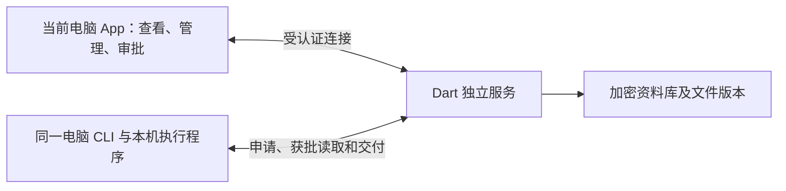

# Dart 服务端：先跑通一台电脑，再扩展多设备

2026-11-08。按本会话开发经历与用户最新要求修订。产品范围和 Dart 路线已确认；用户已确认下列 **12 张首轮工单、3 张后置工单**并授权发布到 GitHub。15 张工单已发布，正文、标题、标签和 17 条原生前置关系全部回读核对通过；A/L 是方案编号，GitHub 实际编号见下表。工单发布后用户已启动持续开发目标；当前执行状态见[开发接续记录](execution.md)。真实资料、正式安装及 #103–#105 仍后置。

## 先交付什么

**第一步先证明：一台电脑上的 App 能把资料保存到独立服务器，换一份空白客户端配置后仍能重新取回。** 随后把现有目录、模板、提案、文件、凭据、回收和备份接上。同一电脑的 AI 通过 CLI 申请，由这台电脑的 App 审批；App 退出不影响服务器和已有有效许可。

这里的“一台电脑”是第一轮开发和验收范围。沿用已经确认的在线方式：服务器保存唯一的正式资料，各客户端通过接口读写。不是维护本地与服务器两份可离线修改的库，不新增双向冲突合并。最终新版本只保留服务器模式，旧单机版及备份作为迁移退路。

第二台物理电脑、另一平台的原生验收、跨电脑审批及多端提醒后置。服务端从一开始保留正常的用户审批接口，不人为限制只有申请电脑能批准，避免后来重做授权规则。

## 已确认的产品规则

- 单用户、自托管 Docker、局域网使用；不做多人、手机端、网页管理端、公网穿透。
- 填服务器地址和 Token 接入；Agent 身份不能调用管理或审批接口。资料共享不表示所有聊天共享授权。
- 服务器可以解密，数据加密保存；运行密钥与镜像分开保管，不将加密存储理解为服务器无法读取。
- 必须联网使用，不做离线读取、编辑或草稿。断线明确提示，不暗中回退到旧本机库。
- 同步范围包括信息、文件及全部版本、凭据、目录、标签、顺序、回收站、模板插件和审批历史；主题、字体、窗口等偏好留在本机。
- AI 新增和修改走提案；用户本人手动编辑直接保存。整份提案内容齐全后一次保存，不允许部分入库；保存不等于授权 AI 使用。
- 新增展示最终内容，修改展示前后差异，并显示类型和目录；复用插件展示，不加演示入口或另一套预览。
- 用户在提案直接补填密码并可查看明文，不再单独审批自己填写的值；沿用既有人工密码、Agent 已知密码、Token 与密钥文件的处理规则。
- CLI 不要求 App 开着；文件领取、SSH 和凭据使用在 AI 所在电脑执行，不迁到资料服务器执行。
- 普通服务重启可延续原聊天仍有效的许可；不续期、不复活结束或撤销的授权。备份恢复与首次迁移重新建立身份，不恢复旧许可。
- 保留原有版本检查，不新增复杂的并发合并界面。保留手动加密备份及独立恢复材料，暂不开发自动备份调度。
- 首次真实迁移以已整理的 Mac 资料为准，不自动合入 Windows 测试库。真实迁移与正式安装另行集中交付。

## 实现方向

复用现有 Dart 资料规则、整体提案保存、授权、版本、历史和 SQLCipher 存储；Flutter 复用工作区数据来源接口及模板展示。只有服务进程打开数据库，各客户端不直接挂载或复制数据库工作文件。

新工作集中在独立启动、Linux 密钥保管、远程用户接口、连接身份、文件实际传输及有效授权恢复。现有仅限本机的 Agent HTTP 不能直接改监听地址对外使用，也不能把 App 原有管理能力一并开放给 CLI。

先验证最小服务、实际加密库、基础恢复和重试结果，再接正常 App。用户/Agent 身份、资料与操作编号、服务器身份及错误格式尽早确定；后续业务逐项复用，不先写覆盖未来所有功能的大框架。

第一轮可在当前电脑的 Docker 中运行独立 Linux 服务；不需要先连真实 NAS 或云主机。记录实际验证的容器架构。选择正式部署机器与目标架构验证留到 L01，不能将当前机器上的容器结果扩大为所有服务器都支持。

## 复盘后如何减少返工

详细证据见[开发复盘](retrospective.md)。这次采用以下执行方式：

1. **先确认具体行为，再做功能。** 把“同一提案多项里有一个缺密码”“从空白客户端重新拉取”“重启前批准、重启后继续使用”等例子写成验收条件。沿用已确认规则，不自行添加演示按钮或新产品流程。
2. **从一开始测试正式装配。** 使用实际内置模板、插件目录、文件驱动、加密存储与正常入口，只隔离资料、配置及系统密钥。允许对系统交互做替代测试，但明确其不能代替原生验收。
3. **每票做必要检查，不每票安装日常 App。** 功能级测试随开发完成；阶段候选再做整体连续试用。已通过检查只在相关改动、失败或新风险出现时重跑，不每个小改动都重复全量测试和打包。
4. **开发获准后连续推进可做的票。** 按真实前置条件选择任务，不机械按编号全部串行。某项等系统密码或第二电脑时，记录到后置票并继续独立任务；首轮功能缺陷则必须修好，不能随意移到后置。
5. **尽早让新 Agent 按说明试用。** A03 验证接入和申请，A12 验证完整录入。只给正式说明、隔离环境和合成来源，不喂分类、数量、关联、版本或操作答案。协调侧可通过正常用户接口批准合成请求，不给 Agent 审批权限。
6. **正式安装只集中做一次候选交付。** 开发使用隔离库、临时身份和测试密钥，不逐票访问个人钥匙串。新版本签名仍可能触发系统确认，不承诺永久免提示。
7. **清理成为测试结束动作。** 固定工作目录，先停止所属测试进程，再清理可重建 App、副本、dSYM 和临时库。保留最新候选、必要失败证据及恢复材料，不积累每轮大包。
8. **汇报看实际结果。** 记录哪条用户流程已通、当前版本和测试范围、下个可执行任务；把自动通过、原生未测、另一平台未测分别写清，避免大量测试数掩盖未接通入口。

这些是后续执行约定；本次只整理并发布工单，不启动开发。

## 工单拆分

每票都有可独立核对的实际结果，单独正文位于 issues 目录。编号表示阅读顺序，不要求全串行。A04 的完整目录管理不阻塞 A06，因为提案需要的基础目录查询已在 A02、A03 接通。

| 编号 | GitHub | 工单 | 直接前置 | 完成后能做什么 |
|---|---|---|---|---|
| A01 | [#91](https://github.com/ShiJiJS/chiyo/issues/91) | [独立服务保存资料，重开后仍能取回](issues/a01-independent-server.md) | 无 | 独立 Dart/Linux 服务保存一条合成资料，重启容器后从全新客户端进程取回。 |
| A02 | [#92](https://github.com/ShiJiJS/chiyo/issues/92) | [App 连接服务器，保存和重新拉取资料](issues/a02-app-save-and-fetch.md) | A01 | 在当前电脑的 App 填地址和 Token，保存、查看和修改资料；换空白客户端配置后仍能取回。 |
| A03 | [#93](https://github.com/ShiJiJS/chiyo/issues/93) | [同一电脑完成 AI 申请、审批和读取](issues/a03-same-computer-approval.md) | A02 | AI 用正式 CLI 申请文字资料，用户在同机 App 批准；App 关闭或服务重启后仍可使用原有效许可。 |
| A04 | [#94](https://github.com/ShiJiJS/chiyo/issues/94) | [目录、标签、移动和排序保存到服务器](issues/a04-directories-tags-order.md) | A02 | 用户在 App 整理目录、标签及顺序，重新连接后仍保持整理结果。 |
| A05 | [#95](https://github.com/ShiJiJS/chiyo/issues/95) | [App 和 CLI 使用服务器当前的模板与例子](issues/a05-dynamic-templates.md) | A03 | App 管理模板插件后，CLI 查询相同的模板、字段和例子，并能按返回格式准备资料。 |
| A06 | [#96](https://github.com/ShiJiJS/chiyo/issues/96) | [AI 提交新增和修改，App 一次保存整份提案](issues/a06-text-proposals.md) | A05 | AI 查看目录和模板后提交文字资料，App 展示新增或修改对比，一次保存整份提案。 |
| A07 | [#97](https://github.com/ShiJiJS/chiyo/issues/97) | [上传普通文件，获批后下载到本机](issues/a07-ordinary-files.md) | A06 | App 或 AI 保存附件及版本到服务器，确认后 AI 获批把指定版本下载到自己的电脑。 |
| A08 | [#98](https://github.com/ShiJiJS/chiyo/issues/98) | [密码、Token 和密钥保存在服务器](issues/a08-credential-ingestion.md) | A06 | 资料与凭据一起提交，App 直接补填缺少的密码，整份齐全后一起保存。 |
| A09 | [#99](https://github.com/ShiJiJS/chiyo/issues/99) | [服务器批准凭据使用，本机执行 SSH 和命令](issues/a09-local-credential-use.md) | A08 | App 批准后，CLI 在 AI 所在电脑执行 SSH、Token 注入和凭据文件使用，服务端只核对与交付。 |
| A10 | [#100](https://github.com/ShiJiJS/chiyo/issues/100) | [回收、恢复和历史从服务器读取](issues/a10-recovery-and-history.md) | A04、A07、A08 | App 可回收整组目录及内容、恢复资料与版本，查看准确的审批和使用历史。 |
| A11 | [#101](https://github.com/ShiJiJS/chiyo/issues/101) | [完整备份恢复，并演练旧版资料迁入](issues/a11-backup-and-migration-rehearsal.md) | A09、A10 | App 导出服务端完整加密备份，在空服务器恢复；现有单机格式的合成资料也能完整迁入。 |
| A12 | [#102](https://github.com/ShiJiJS/chiyo/issues/102) | [统一打包并自动试用当前电脑的联网版](issues/a12-candidate-and-autonomous-trial.md) | A11 | 形成匹配的服务端、当前平台 App、CLI 和说明，用合成资料连续试用并修正问题。 |
| L01 | [#103](https://github.com/ShiJiJS/chiyo/issues/103) | [集中安装新版、迁入真实资料并处理系统确认](issues/l01-real-install-and-migration.md) | A12 | 最终候选集中完成必要原生检查，验证真实备份后迁入选定局域网服务器，再切换日常 App。 |
| L02 | [#104](https://github.com/ShiJiJS/chiyo/issues/104) | [第二台电脑接入并完成另一平台验证](issues/l02-second-computer.md) | A12 | 另一台电脑填写地址和 Token 后取得同一套资料，验证该平台的 App、CLI 和本机执行。 |
| L03 | [#105](https://github.com/ShiJiJS/chiyo/issues/105) | [另一台电脑审批，并同步待办和处理结果](issues/l03-cross-computer-approval.md) | L02 | AI 在一台电脑申请，用户在另一台批准，原电脑继续使用，在线 App 更新待办状态。 |

优先完成 A01、A02，即得到保存与拉取的第一条实际结果；随后 A03 接通同机申请。A04 和 A03 可分别推进；A06 后文件 A07 与凭据 A08 可分别推进。各条流程通过后在 A11、A12 汇总恢复与整体验收。

A12 是首轮开发完成点。L01、L02 可分别安排，均不阻塞首轮。L03 等另一电脑可用后开展。L03 作为后续需求保留，不以“第一阶段必须全做完”要求立即开发。

## 首轮完成与正式交付的区别

首轮完成须有当前平台一致版本的 App、CLI、本机执行程序和服务端，有合成资料完整自动试用结果及新客户端重新取回的证据。用户可以在后续交付时用这个候选开始体验，而不是等待两台实体电脑的所有场景验完。

首轮不代表真实资料已迁入、日常 App 已替换、所有原生系统操作已通过，或另一操作系统已可用。Mac 原生焦点填充仍沿用已有 #51；Windows 原先支持的填充及其他本机方式在 L02 接入和实测，不用 Mac 结果替代。

L01 切换前必须以当前候选通过必要原生检查，导出真实资料完整加密备份并独立恢复验证，再停旧库写入、迁入空服务器和核对。失败保留旧库及回退版本；成功后只保留最新交付和必要恢复材料。这里是交付计划，不是本次操作真实资料的授权。

## 当前进度与继续入口

- 用户已授权连续开发 #91–#102，#103–#105 后置。
- 开发分支：codex/server-first-stage；首次从规划分支创建，保留已确认的领域记录。
- 当前 #91–#96 已完成并关闭；#97文件上传、预览、版本提案、本机另存/打开及CLI获批领取和副本清理已完成首轮自动验收。
- 下一步 #98 凭据录入，随后按依赖推进#99–#102。统一候选尚未交付；#103–#105仍后置。
- 继续执行见[接续记录](execution.md)，浏览器当前工作页见接续记录，先复用现有页面。

## GitHub 发布安排

2026-11-08 已检索仓库现有 86 个 Issue 标题和服务端相关词，未发现覆盖本轮的新工单组；这个结果仅代表当时查看，发布前仍需检查并发新增的重复票。已完整阅读 [Mac 密码填充 #51](https://github.com/ShiJiJS/chiyo/issues/51) 的正文及活动，它是后续独立能力，不复制建票或阻塞本轮。

本轮来源是对话，没有修改或关闭旧单机父票。用户确认拆分后，由主 Agent 定稿正文，并按用户指定交给 GPT-6.1 Sol（high）发布。A01–A12 对应 #91–#102，L01–L03 对应 #103–#105；全部设置 ready-for-agent，L 组正文明确后置且不随首轮自动开工。17 条 GitHub 原生前置关系已建立，正文中的关联引用使用实际链接。

逐票保存后刷新页面，等待关系列表加载完成，再回读完整 Markdown、标题、标签及原生关系；15 张均与本地定稿一致，17 条前置均无多余或隐藏项。主侧再次比较本地正文与回读全文及摘要，结果一致。发布记录见[逐项核对结果](publication.json)；浏览器工作页已结束。本轮没有改业务代码、提交/推送 Git 分支或操作正式 App。

与上一版 S01–S15 相比：拆开基础服务和首个 App 流程；把 S02 的跨电脑审批后置；取消它对目录等管理功能的不必要阻塞；把 S12 授权重启按资料类型提前，S13 最小恢复提前到 A01；统一正式交付和另一平台验收为后置事项。旧草案已替换，不保留两套可执行计划。

## 依据

- [开发复盘](retrospective.md)
- [联网方式及首轮范围](../../adr/0024-online-multidevice-service.md)
- [服务器重启后的有效授权](../../adr/0025-server-grants-survive-restart.md)
- [沿用 Dart 与加密 SQLite](../../adr/0026-reuse-dart-for-server.md)
- [整份提案一次保存](../../adr/0020-save-whole-import-proposal.md)
- [工单依赖数据](tickets.json)

