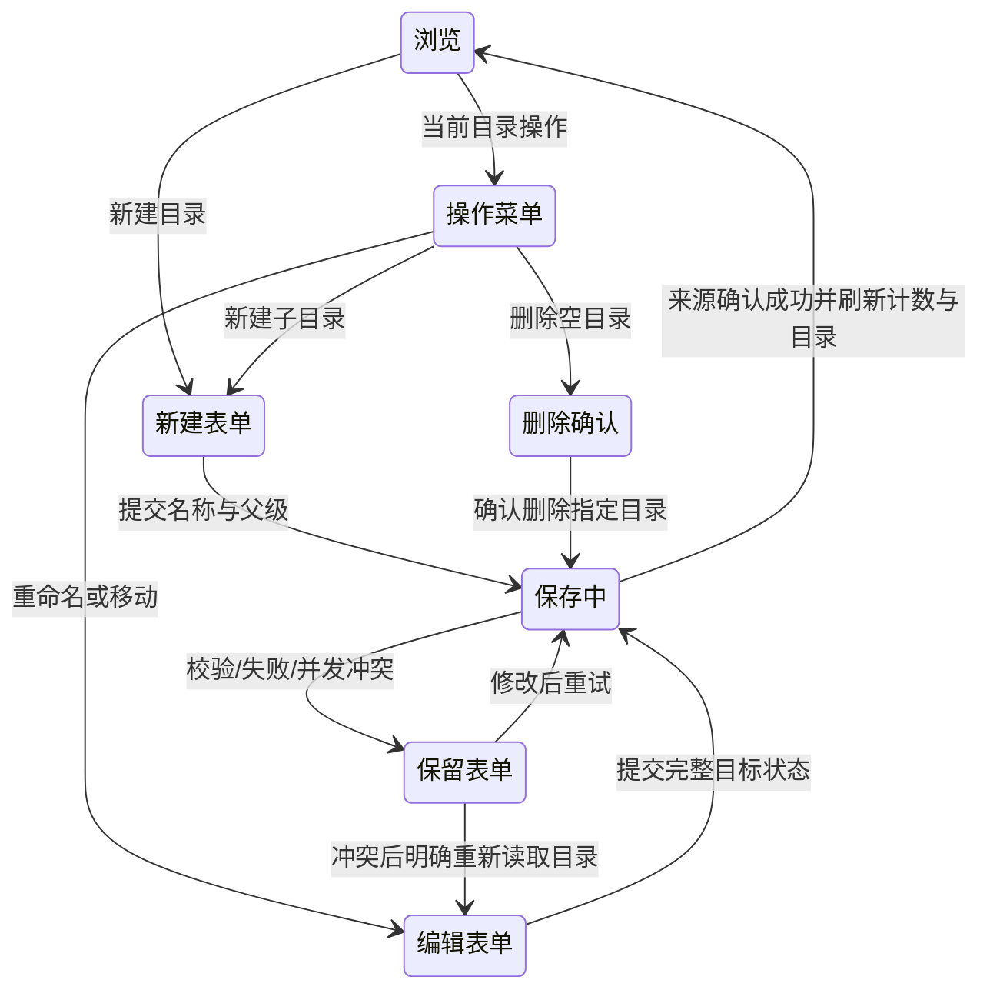

# U02：信息库目录就地操作补充

沿用Round09三栏与共享按钮、菜单、弹窗，不改变授权或持久化语义。目录导航回答“查哪一组资料”；选中实际目录后，目录标题旁的“目录操作”菜单承接新建子目录、更名/移动、空目录删除；菜单不占用行内名称和计数空间；虚拟的全部资料和未分类不可改名或删除。新建目录入口一直可达。独立目录/标签管理页面仍由U07承接。

最小状态图：

名称1–200字，不用斜线当路径；同父级忽略首尾空格与大小写不能重名。父级必须存在，不能移动到自身或后代；同名目录位于不同父级时，选择器以完整目录路径区分。移动只改变父级，不复制目录或改资料身份。空目录删除检查子目录、当前信息和当前凭据；当前修订/回收历史不由此重写，遵循ADR0014。

表单正文滚动、底部操作固定。保存中禁止重复提交与离开；失败保留名称/父级；脏草稿关闭先提示继续编辑或明确放弃。目录目录版本冲突后，用户明确重新读取再核对草稿，不能自动用新版本重试。未知结果先核对，不立即重复提交。

成功后统一来源通知刷新树、目录路径、数量和列表；查询所用目录或标签被移除则仅清除失效条件、回第一页并提示，其他条件保留，详情随新结果更新。资料编辑与目录父级共用目录路径选择组件。新建父级默认当前实际目录；从全部资料/未分类进入默认顶层。

复用既有150ms按钮、120ms菜单和180ms弹窗；没有新的动效或布局系统。当前阶段只在隔离内存来源操作，真实本地服务接入由F01后续拆分。当前用户已恢复持续Mac开发，本文不是暂停指令。
