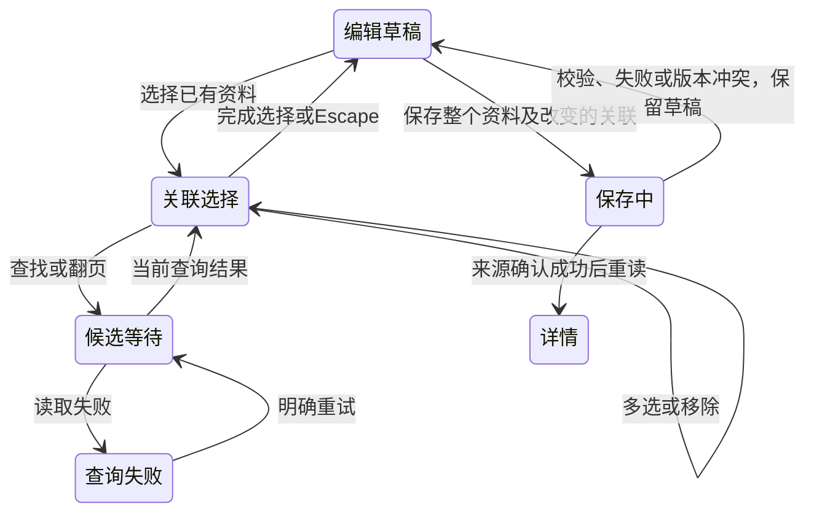

# U02：关联选择与通用资料编辑

沿用冻结原型的“编辑资料 → 选择已有资料 → 保存”流程。选择器从表单按钮打开共享锚定菜单，复用单侧展开/空间不足向上翻转、120ms动效、Escape/外部点击关闭及焦点返回；不另开一层表单弹窗。菜单内搜索、列表与分页分别占位，候选正文独立滚动。它显示资料名称、类型和用途，关键词只查元数据。模板定义的targetTemplates决定候选类型；空数组表示不限制类型，不根据关联名称猜测字段含义或额外授予访问能力。

最小状态图：

- 已选对象独立于当前候选页显示；搜索/翻页不会偷偷清除隐藏选择。不存在的旧目标明确显示不可用，允许明确移除，不静默忽略其身份。
- 只提交本次改变的关系key；其他旧关系保留。校验自身、同key重复、类型和失效目标；普通关系允许环，不套用目录防环规则。关系事实只维护一份来源记录，不维护可各自修改的反向副本；真实Owner/凭据linkedItemIds适配仍由F01接入时核对。
- 保存使用同一资料版本和操作身份，字段与改变的关联共同成功或失败；不能先显示成功再等待来源提交。关联不扩大授权；通用资料接口不读写托管凭据正文或其关系。
- 关闭候选菜单取消该区晚到查询的显示；输入更新只接受最新查询结果。候选查询失败保留已选范围，错误和重试位于选择区域。Escape优先关闭当前选择菜单并回到触发器，第二次离开表单仍受脏草稿保护。
- 旧note按已有内容种类显示通用阅读与正文编辑，不按名称推测成服务器。原有其他值保留并可读；未知复合结构只读，不在标量表单中转成字符串覆盖。新建通用资料使用宿主空白定义，不复制一份旧资料的值或额外字段。

本阶段是正式Flutter界面的隔离内存实现；没有新增数据库、权限、系统调用或秘密执行。布局和原有120/150/180ms动效继续复用共享层；完整S5与最终系统输入范围仍按主票跟踪。
