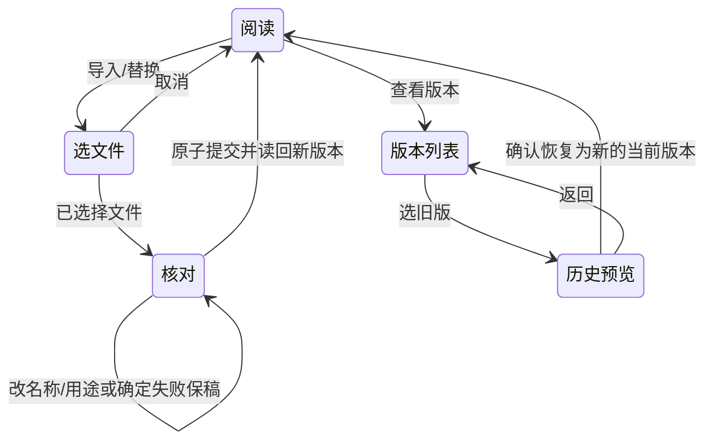

# U03：文档与普通文件流程

沿用冻结R06的阅读正文、文件工具区、版本和关联；Owner从同一信息库查看内容，不切到另一套演示页面。视觉沿用Mac字体、共享Desktop控件及120/150/180ms动效，不重选风格。无装饰素材；PDF页面是实际内置PDF的渲染结果，不绘制假简历纸面冒充文件预览。

文档用一个正文文本字段及独立格式值（plain/markdown），同一版本化表单编辑并读回；列表只含名称/用途等元数据，不搜正文。Markdown以受控Flutter节点展示，不执行HTML、脚本、图片加载或外部链接；原文可完整查看。未知格式按原文显示并提示，不丢内容。保存失败保稿，冲突/未知结果沿用已有核对流程。

文件是信息项里的普通文件字段，`WorkspaceDetail`只保存不可变附件身份/版本引用，不放字节、文件路径或执行句柄。专用Owner接口按明确打开的对象读取元数据/页面；版本列表不提前读所有文件正文。渲染后的页面像素与原文件交付分开。来源替换后共享资料变化通知使各处失效，不在Widget另存一份版本真相。

替换/恢复核对expectedRecordVersion、附件当前版本及operationId；每个成功结果唯一。文件恢复生成新版本，旧版本不可变；普通正文保存不得覆盖文件引用。信息修订/回收恢复也须通过同一文件版本映射，不直接把当前头指针倒退。永久清理去掉本记录版本/正文；合成fixture显式重置不等于真实擦盘。

文件操作使用随机128位操作身份，未知结果保持原身份并先查询回执。查询失败与已确认未提交不同，不能把超时当成可安全重试。正式适配还须持久保存待核对操作并在导航/重启后恢复核对；当前局部表单的待核对状态不等于已有完整持久化操作日志。

预览支持实际PDF分页、PNG和纯文本；未知格式显示完整元数据并保留“用本机程序打开/另存”入口。预览等待/错误/不支持三种状态分别表达，错误能重试。UI阶段选择、打开和另存经注入的示例接口返回，不能执行系统程序或向任意路径写文件；真实文件面板、受管临时副本和打开能力归F01适配。选择器由组合入口注入，页面不认识示例资源名。

内置文件仅虚构资料，元数据以实际文件大小/格式/版本计算。已知样例适配器可使用与文件hash绑定、由Poppler产生的预渲染页面；这证明文件内容预览，不宣称实现任意PDF解析。真实Owner适配器需在同一预览接口后接受管资源渲染、清理及授权边界，不把此fixture机制带入生产。原冻结HTML和个人文件不修改。

完成检查包含：文档格式/恶意HTML及远程图片不执行、编辑失败保稿和重读；文件预览按需、切对象丢弃旧结果；取消/失败不改变版本；替换/历史预览/恢复/重复操作；混合信息保留文本和关系。完整两主题/两尺寸/200%、新上下文动效与原生R06后继集中收口，未验不勾选S5。

## Mac r11：阅读工具区与元数据重读

当前附件工具区合并版本、文件名、格式、分页、缩放和文字切换；版本按钮打开原历史流程，格式按钮打开只读“文件信息”（完整文件名、MIME、真实大小/字节数、附件版本），关闭回到同一阅读位置。替换、另存、用本机程序打开及刷新预览收进现有锚定菜单，Escape/外点关闭和焦点归还沿用共享控件。文本和未知格式也保留Owner动作，不以没有图像工具为由隐藏它们。

同一信息项只改元数据：保存→隐藏旧预览并重读附件身份→同一附件恢复原页码/缩放/文字模式；元数据读取失败则显示重读入口、保持旧画面隐藏、禁用文件动作。重试确认同一附件后恢复阅读状态。替换/恢复确认新的不可变附件ref后页码、缩放及文字模式重置；切对象/字段/来源丢弃旧结果。这里只保留页面阅读状态，不写服务版本或增加持久化操作；原未知结果先核对规则继续生效。
