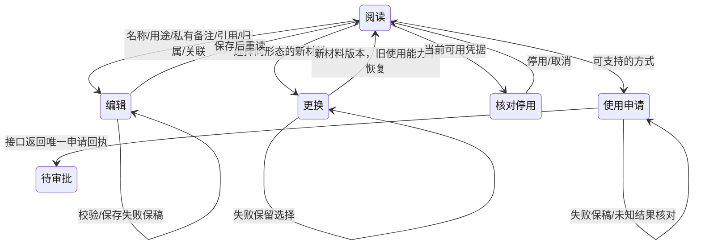

# U03：凭据专用界面与示例操作

沿用冻结R06的凭据摘要、用途、使用方式与关联，使用同一信息库和共享Desktop控件。原文不经普通详情或附件接口返回；界面阶段仅显示掩码。创建/更换从专用来源提供的不透明候选身份选择虚构字符串或文件，不读取用户文件、Keychain或秘密。Mac焦点填充默认不可用，仅演示原因；SQLite会话文件只保管。

材料输入通过组合入口注入的WorkspaceCredentialPicker进行；表单只接收供保存核对的材料元数据及不透明暂存身份，不认识合成候选列表。当前组合入口提供合成选择器，未来在同一个端口接现有Mac安全输入/文件选择，再由正式适配器将暂存身份交给Owner服务。取消不改草稿，换选/离开释放表单持有的暂存租约；已提交或结果未知的操作由服务独立持有引用并负责回收，释放UI租约不是取消写入。合成候选只有元数据，releaseCandidate不创建/删除实际文件或秘密缓存；正式暂存及故障清理仍须F01验证。

材料版本与资料修订分别记录。停用对应现有setCredentialEnabled(false)，不是删除文件，也不是只撤销一个grant；重新启用不复活旧授权。更换保持字符串/文件形态，停用时更换也不自动启用。资料名称沿用核心60字上限、用途2000、Owner私有备注4000、引用名64；关联最多200个普通信息身份。普通资料保存仍不能写凭据正文或凭据关联。

凭据关联复用同一个事实，Owner从信息侧或凭据侧修改后，另一侧由相同事实投影；不新增能独立写入的反向副本。涉及关联的资料修订须一并更新，旧表单进入冲突；快照/回收恢复仍按合法当前身份重连，不凭同名替换。

使用申请明确会话/申请者自述、用途、凭据及版本、注入方式/接收器和期限；程序/参数来自结构化方案，不执行任意shell替换。提交只产生待审批申请，不签发能力或启动进程。使用记录按一次授权下的多次操作分层显示，不含密钥、实际临时路径或可执行句柄；已有历史仅虚构，审批和执行工作台由U05/U06继续接入同一来源。

写入使用expectedRecordVersion、expectedMaterialVersion及随机operationId，未知结果先查原回执；失败不增加版本，不重复创建或提交。示例内存操作日志不宣称导航/重启后的生产恢复保证；真实适配须接现有持久化操作事实、固定版本/期限及接收配置。完整S5与实际OS输入仍单独保持开放。
