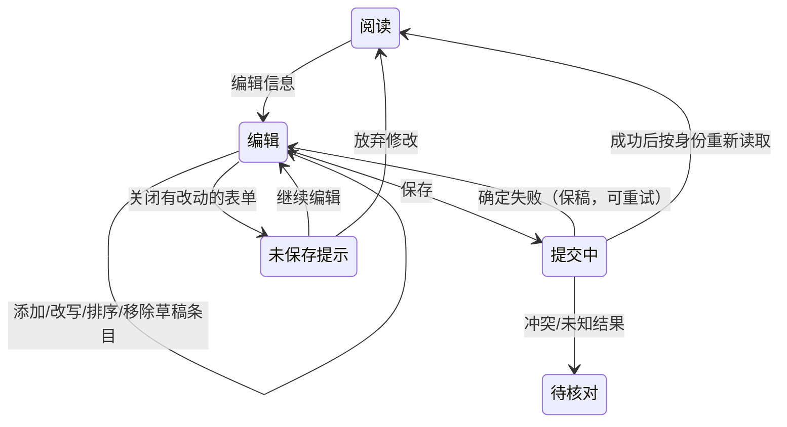

# U03：个人档案重复条目流程

沿用冻结R05的基本信息、教育/工作时间线及同一个共享编辑弹窗。主人要把新经历补进档案并调整顺序；保存后在原档案看到完整经历。品类是资料阅读工作区，首屏主角是档案内容，主动作是编辑信息。只复用冻结视觉、Mac字体和Desktop控件，不新选风格或生成装饰素材。

现状：打开档案→编辑信息后没有经历控件，无法完成任务；阅读区把条目拼成文字。目标路径：打开档案→编辑信息→添加一段并填写→上移/下移→保存→同一资料读回。输入不另计点击；失败留在同一表单，草稿、条目身份及输入位置保留；退出沿用未保存保护。删除先只改草稿，保存后提交；取消不删除原条目，不增加第二层危险确认。

表单每段使用标题、时间、说明；上移/下移/移除为低强调动作，前后端都保持固定条目和叶字段身份。条目仅展示中性序号，内部ID不放到可见标签。控制区在200%下换行，正文独立滚动，标题/保存区固定。新增和排序不另加动画；弹窗、按钮和结果提示继续120/150/180ms共享token，实际新上下文仍需S5核对。

界面合同沿用`WorkspaceDetail.values`和版本化整条保存，entries结构由共用类型读写：entryId、title/period/detail、各自fieldIds。合成来源在加载旧冻结fixture时补稳定身份，界面不能从学校名生成身份。新增分配全新身份；修改/排序保留，移除后的旧身份不能由普通保存重用。显式版本/回收恢复按当前存活身份映射，已移除条目使用新身份；历史原文不改。真实服务适配仍须用核心实际字段ID及授权失效事务，UI身份不代表已经实现权限。

资料元数据名称与档案“姓名”是两个字段；Widget key及失败定位不能互相覆盖。元数据错误仍用`name/description`，同名模板值错误由`workspaceValueErrorKey`映射为`value:name/value:description`，其他已有模板错误key保持兼容。重复条目错误定位为`集合key:entryId:子字段key`，不依顺序定位。

保存校验：每个entries字段最多100段，整条资料最多200叶字段；非空条目标题必填且≤160字，时间≤160字、说明≤2000字，身份必须唯一，旧条目叶身份不能换。超过预算/损坏的旧值完整只读，不截断或用字符串覆盖；真实限制与迁移/备份预算由F01核对，未增加正式服务上限。

验收先走真实Flutter入口，覆盖新增/移动/删除/失败保稿/取消/读回和来源拒绝伪造身份、超限及历史不变。明暗两尺寸和200%离屏图仅是局部检查，完整原生R05/S5、真实OS输入留在#64开放项；无独立评审、无子Agent或computer use。文档/文件/凭据流程在同票后继补齐，不因档案子范围完成关闭整票。

预算核对：`info_core.dart` Owner创建、`information_draft_access.dart`更新和`backups.dart`/`backup_history.dart`当前每项上限200字段，因此依S1的“沿用更小限制”采用200，没有修改正式服务/备份上限。Agent提案导入另有每项50/每批200预算，留给F01及U05/U06适配，不能据Owner预览扩大Agent能力。
