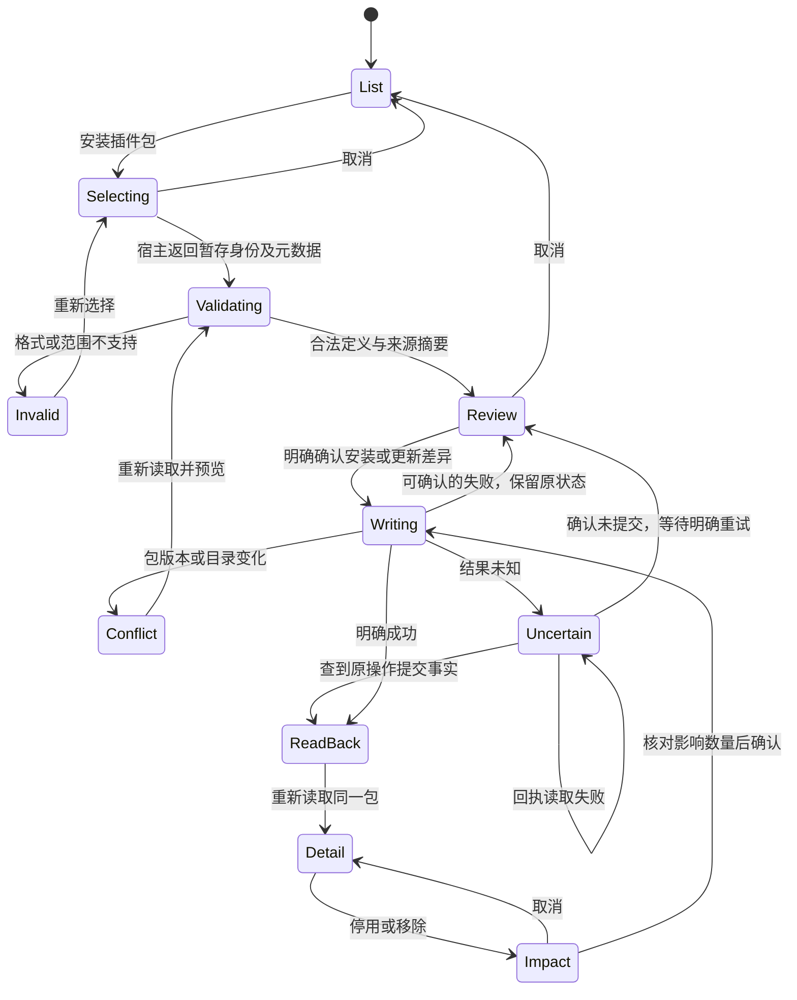
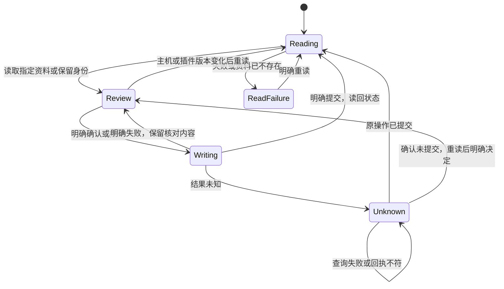
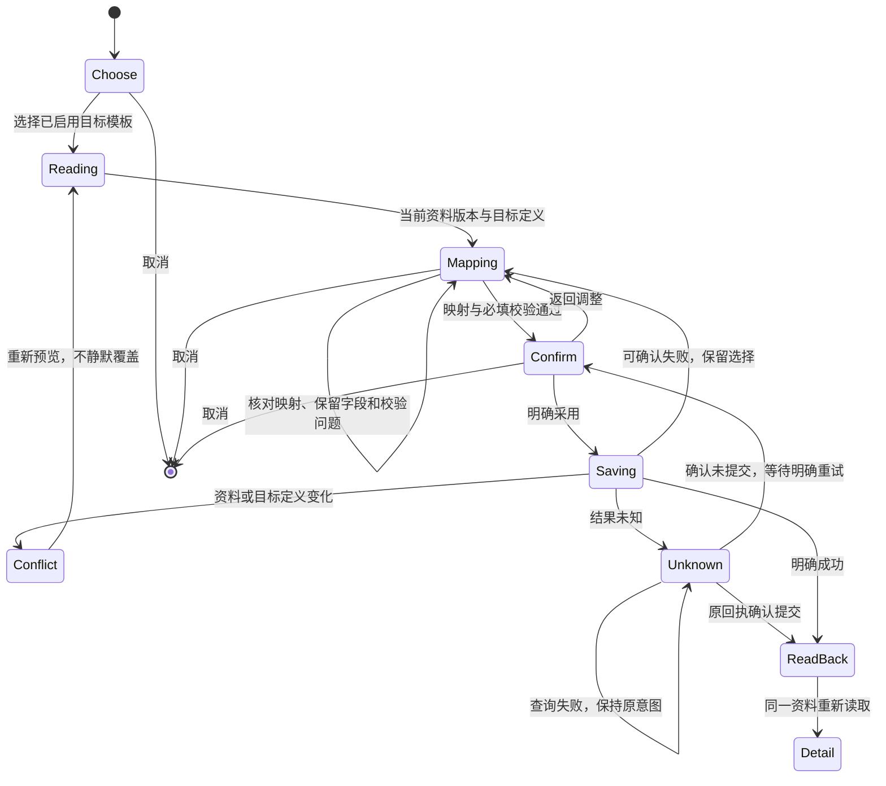
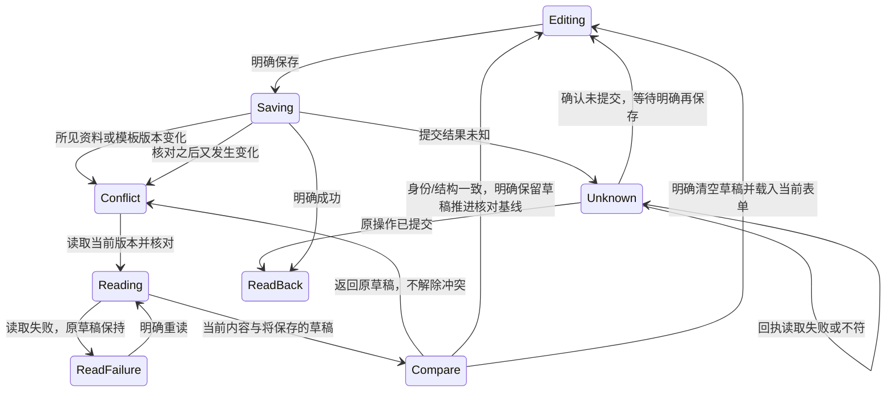

# U04：安装、维护与采用模板的状态流程

用于[#65](https://github.com/ShiJiJS/agent-info-manage/issues/65)的前端实施准备。沿用冻结R07/R08、S1-D05、S2及拟议ADR0016，不批准真实插件后台或改变现有授权规则。当前仍为合成预览；r1已实现下述包安装/维护流程，r2已接单台主机，r3已接普通资料采用；r4已接旧手建模板兼容/local转换与制作指引，具体完成项见[U04记录](issues/U04.md)。

用户从“设置 → 插件”查看包及模板，在确认来源自述、结构与影响后安装或更新；从已有普通资料选择目标模板，先核对映射与保留内容再采用。结果应是可重新读取的同一资料及其不可变模板快照，资料身份、分类和未映射内容保持，不能以成功提示代替结果。

## 包的安装与维护

安装预览包含名称、作者自述、来源/摘要、版本、模板列表及字段/章节/关联结构；自述不变成可信徽章。输入取消不产生写入。校验错误显示路径与原因，不拿虚构“已验证”替代解码/范围检查。包大小、深度、重复键/身份、hostApi、版本、类型/图标/布局白名单及引用限制按S2；外部包不能覆盖builtin命名空间或挂接宿主设置面板。

更新显示新建定义的差异；同版本不同摘要拒绝，已有资料快照不跟着更新。停用限制后续新建，移除只移除包，既有资料、附件、凭据关系、修订和信任记录保留；缺包资料可用通用视图继续读取和编辑。确认页显示影响数量及保留范围，失败不留下半安装状态。列表/详情、启用类型选择器与信息库使用同一变化来源。

## 单台主机设置

宿主仅为内置服务器注册设置入口，其他包没有空白设置页签。状态按规范化host＋port和指纹区分：未取得指纹、待核对、已确认、指纹变化、已撤销；改host/port不能继承原确认。详情入口和插件设置读取同一事实，不能保存两份独立布尔状态。

停用或移除后仍能查看及撤销既有确认；再次确认要求服务器包启用并已取得指纹。安装、启用及采用模板都不自动信任主机，凭据使用申请另外处理。预览只更新合成事实，不读known_hosts、不执行SSH、不接触系统秘密。真实导入与核心主机校验继续留给F01。

r2实现核对状态的共同来源和一次性对象跳转，关闭后普通返回不重复弹窗。确认/撤销核对资料、插件、端点与身份版本；冲突返回重新核对，结果未知冻结原意图并查询无正文回执。资料移走端点后旧身份仍可维护，查看/撤销不依赖插件启用。

## 已有资料采用模板

映射逐字段显示来源、目标、同义/形态判断和处理结果；未对应、形态不匹配、含义待确认的旧字段保留，不能按同名自动猜测。明确同义且同形态的字段保留实例身份；含义改变展示为新字段，来源分配新身份，旧授权不扩展/复活。保留目录、标签、附件版本、凭据关系和原修订；托管凭据拒绝转换成普通资料。旧手建模板继续兼容，显式local包转换不批量改写历史实例。

采用预览由来源生成，包含资料expectedVersion、目标定义身份/版本/摘要与映射计划。确认提交原计划并核对双方版本，一次更新生成新资料修订和快照；冲突必须重读计划。结果未知保留原操作身份与原映射，不能通过返回上一步或换模板重发。生产事务、叶身份及固定授权失效、持久日志和完整备份仍由后续实际服务承担，UI检查不能冒充这些已完成。

## 实施接缝和检查重点

- 页面依赖可注入的模板目录/命令及主机状态接口；宿主选择端口只提供暂存身份/元数据。集中合成包、无效包和主机状态不进入Widget硬编码分支，重置恢复同一虚构基线。
- 内置服务器与外部域名走同一模板表单/阅读协议，不按插件ID新增详情页面。设置保持工作台导航，返回保留信息库查询与选中项。
- 检查正常/空结果、确定等待/取消、晚到结果、校验失败、版本冲突、提交回包丢失和回执失败；写后重新读取，保留草稿/映射及未映射字段，核对旧实例快照未被包更新/移除修改。
- 沿用共享控件及120/150/180ms反馈，错误在原处显示；明暗、两尺寸和大字检查与完整S5/实际OS输入分开记录。只保留一份固定预览App及必要证据，完成后清理本轮草稿输出。

## r3实现补充

普通资料采用按上述长流程实现，previewAdoption只读生成有限租约计划；确认核对原资料/插件目录/目标快照，和原修订、稳定实例身份一起提交。实例自己的保留字段/关系描述与目标定义分开，同名旧字段不覆盖目标，复合未知内容只读保留，附件/经历仍使用专用入口与原身份。步骤更换回顶部，映射和值保留；未知锁定原计划并查共享无正文回执，确认未提交需重新预览。只处理合成来源，不意味着旧手建模板转换、生产迁移或完整S5已完成。

## r4：旧版模板兼容与显式转换

旧版模板目录读取元数据，不预加载任何资料内容。用旧模板录入仍为通用资料，每份记录及字段实例独立；附件逐项由宿主选择。保存前核对旧模板版本、完整字段对应和选择，异步附件校验后再次核对版本/资料集及原operationId，失败无部分写入。成功从同一信息库读取，原模板保持。

显式转换先生成候选，再走已有Validating→Review→Writing/Unknown→ReadBack流程，来源版本/字段定义映射一同展示；改动旧模板需要重预览。当前转换版本已安装时进入包详情，旧录入仍可用。附件或超过40字段不能转换，展示明确原因且保留旧表单；其余声明预算由同一解码器检查，不截断旧内容或改成不等价类型。Agent制作指引展示上次读取的目录版本、实际只读校验命令和虚构JSON，校验/安装/录入提案是不同步骤，不构成访问批准。

## r5：共用表单冲突核对

读取、比较与推进表单基线均不保存资料。字段、经历叶身份、结构或草稿分类变化时不提供直接保留草稿继续；返回仍保存旧输入，只有明确清空载入才替换它。保留草稿前展示将覆盖的当前可编辑内容；附件/只读内容/未编辑关系使用当前事实，后续再次保存仍按核对版本检查。没有自动合并正文或自动重放未知提交。[完整合同](../../development/zhiyu-plugin-contracts.md)。
