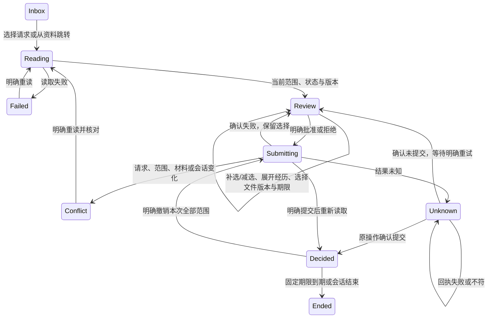

# U05：审批收件箱与决定流程

沿用冻结R09/R10及S4，当前只处理集中、可重置的合成状态。左侧300px（1280时275px）收件箱，右侧申请内容与234px（1280时210px）决定区；200%文字下决定区折到正文后，保留字号、独立内容滚动和键盘动作。复用正式Desktop控件、语义色及120/150/180ms反馈，不新增视觉方向。

查询按全部/待处理/已处理、关键词和分页；选择、各请求的勾选/文件版本/期限与滚动留在根控制器。后台刷新不覆盖未提交选择；所见版本过时需重读，不能静默按新结构批准。提交/未知时冻结请求切换、输入及重复决定，按原operationId查询无正文回执。确认未提交可明确再试，读取失败不等于未提交。

字段批准固定到现存实例fieldId，经历逐叶选择；新增叶不进入旧决定。普通文件另外固定附件版本，只显示用途/文件名/类型/大小等元数据，不读取原文。凭据固定材料版本、使用代次、会话、方式、接收方和初始结构化启动说明；字段期限与凭据期限分开。命令只是首个计划，授权期内复用不续期、每次操作独立，CLI才能注入，普通shell不会展开占位符。

整理只允许限定资料的元数据及目录/标签自动写入，最多30分钟，不读改字段正文，不再批准第二次整理结果。Mac焦点填充默认关闭，显示原因并可拒绝，不显示填充成功。申请者/会话名称和用途均为自述。

凭据详情中已有的Agent申请与收件箱共享原申请身份/状态；顶栏待处理数由同一来源计算。主人不在详情中创建使用申请。结果保留所批范围与固定期限，材料更换、停用、回收、字段删除、会话结束和到期不能恢复原能力。历史/关联跳转使用稳定类型化身份，实际历史界面归U06；这里不执行真实命令、交付文件、修改分类或签发真实授权证明。

真实适配由全部UI后F01核对：普通Owner.approve的reviewedVersions、decideCredentialUse的分路期限/请求范围、组织任务的固定版本、附件交付版本、持久回执及重启找回不能用合成ID替代。预览源只保存决定事实及可失效状态，不把UI勾选当生产授权。

## 单次使用结果（r2）

已批决定与其下操作分别保存和展示。未发生操作时保持空，不从批准推导执行。每条操作带原请求/授权/操作身份、固定凭据版本/使用代次/会话、结构化本次计划和时间；执行状态、退出码、进程结束与材料清理不是同一维度。只读查询原操作；查询失败/缺失/身份不符/观察版本倒退时保留原观察，不把它当“未执行”，也不新增使用或续期。

2026-10-30移除产品中生成三次观察及发布清理状态的合成入口；这些状态仅由测试代码直接准备。正常界面只查询实际原操作。后续观察确认“未知操作进程结束/材料清理完成”后，仍显示结果未知、无退出码，不推断成功。正式核心可能因挂起审计暂时遮蔽已验证终态，只有可信持久回执恢复后才能显示真实终态。整个界面没有重跑、系统填充或材料清理能力；当前只读查询不能被生产适配成重新启动命令。

查询异步按请求、读取代次及查询身份隔离。审批本身已知但单次使用未知时仍可浏览或撤销；审批决定未知时继续冻结原提交。会话结束/撤销/到期阻止新增使用而保留历史结果。统一原操作事实同时投影到凭据详情，U06接同一来源。
