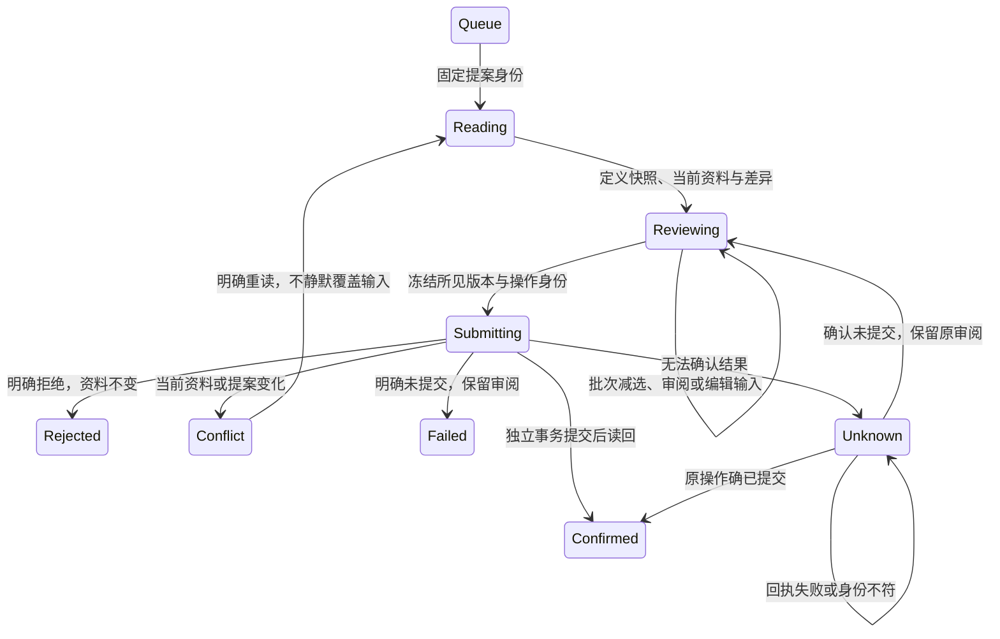

# U06：提案与授权历史的实施流程

沿用冻结R11/R12及S4。授权历史r1和新增/标量修正提案r2已接通正式Widget和集中可重置合成来源，见[历史](../../development/zhiyu-macos-grant-history.md)与[提案合同](../../development/zhiyu-macos-proposals.md)。r3/r4接通整条及单字段删除、字段四类意图与经历叶变化；r5已完成混合队列批量，新整理结果及旧版审阅继续待实现。#67保持OPEN，不能用已完成子流程代替整票条件。根级导航保护包含单次及批量提案未决状态。没有真实Owner写入、SQLCipher、CLI、密钥或系统通知。

## 提案队列与审阅

收件箱提供关键词、待确认/全部/已处理、类型与分页。选择使用稳定提案身份，不按行号、资料标题或当前页索引定位；各提案保留自己的选择/修改和滚动。来源名称、聊天与用途明确为自述。右侧沿用原型纸面阅读，按定义快照的章节展示新增、修改、删除差异；未知/缺包定义用保留的通用结构，不按当前新模板重解释旧内容。

批准范围区分四类：新增批次中的选中资料；修改中明确的correct/add/replace/remove意图；整条或字段删除；已应用整理结果。修正保留原字段实例身份，含义替换使用新身份，经历按实际叶字段处理，不把整个JSON当一个字段。普通附件说明与附件原文、凭据材料继续分离；不提供通用凭据正文/原字节提案通道，现有文件导入保持Owner专用流程。

核心当前语义：confirmImport(id, version, reviewed)在一个新增提案中确认一批经审阅输入；confirmUpdate和confirmDelete各自核对提案/资料版本并走独立事务。因此混合队列批量不能伪装成全局事务。前端冻结选中提案身份/版本及各自审阅，逐项显示已提交、冲突、失败、未知和未开始；已提交项不因后一项失败而回滚或重复写。未知项先查原操作，保留未开始项，后续明确处理，不自动重放未知项。

r5从每份提案的正式入口加入确认或拒绝清单，最多100份提案；这与一份新增提案内的20项预算不同。加入时固定明确审阅的输入，之后单独编辑不会自动改变清单，需明确更新。开始前可调整顺序、移出或清空；提交时逐项预检准确版本和语义。确定失败仅重试该项；未知冻结整个根导航、关闭和Escape，只查询该项原操作。查询成功不会自动执行尾部；确认原操作未提交后，Owner明确重试才生成新操作身份。结果阅读返回原查询、页码、选择与滚动。终态释放提交正文，隐藏的外部已处理项通过元数据刷新失效，不读取原值，也不冒充本批次成功回执。晚到元数据不能解除未知锁。

冲突比较不写入、也不自动把旧草稿套到新字段身份。保存成功从同一来源进入信息库并读回；拒绝不改资料。处理后的提案使用无正文回执/名称摘要，不无限保留待审正文；旧内容通过仍保留的修订/回收快照按需查看。真正清理后反馈不可用，不从回执或同名新资料重建内容。

## 整理结果

新整理授权允许Agent在固定范围内自动应用分类和标签，结果只读显示原目录/标签到新值、无变化、冲突、撤销或到期原因，不出现第二次批准。关联的整理授权与操作历史可跳转。旧版待确认方案不静默变成自动应用结果；它保留原语义和清楚的兼容状态，真实接入前需按ADR0007核对旧版审阅入口。

## 授权历史

列表按关键词、类型、有效/结束状态和时间查找并分页，保留所选历史和列表位置。详情按“批准范围与固定期限 → 多次独立操作”分层；普通字段、普通文件、凭据使用和整理的状态各自表达，不把一次grant当一次执行。

复用U05当前决定/凭据操作的同一事实来源，不再创建另一份可各自修改的批准状态。凭据使用的固定版本/会话/实际计划和原操作查询沿用既有合同，进程结束或材料清理不推断成功。普通信息历史只存批准成员和访问元数据，不携带正文；附件交付记录独立于批准，旧对象删除后仍能说明历史状态。

当前对象存在时按kind和稳定ID进入；不存在时显示历史名称/版本摘要和仍可保留的旧快照，不能跳到同名新对象。返回恢复提案/历史的查询、分页、选择及滚动；整理结果/历史不能跳错到回收站或普通资料的另一种同字符串ID。

## 共用状态与接入边界

页面/控制器只依赖可替换来源，集中来源保存合成提案、决定和操作事实。正常/空/持续等待/读取失败、确定提交失败、冲突与未知结果都从实际入口可重现；失败保留输入，晚到查询不覆盖最新选择。待处理提案数与顶栏同源，重置同时恢复资料和提案/历史，不清理未知个人目录。

弹窗计数和未决提交共同锁定界面/原生导航；外部排队菜单事件丢弃，明确界面“查看资料/前往审批”在弹窗完全结束后执行一次。提案未决状态已并入同一根锁，不能单独重开原生导航。派生Owner旧值在清理后即使处于未知提交也先失效；持有新值差量的草稿不能作为旧值备份。

F01继续等待全部七项UI。真实适配需核对提案版本、资料与字段实例身份、定义快照、现有各自事务/回收/修订、持久无正文回执、跨导航/进程重启找回、批量部分结果、备份恢复及历史清理。合成保存、查询或重置不代表生产业务已完成。
